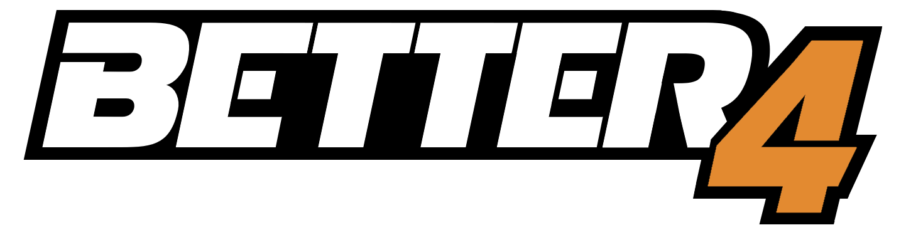

<div align="center">
  </img>

  [](https://discord.gg/k7MKWFqejf)

</div>

Better4 is a THPS4 modpack that includes modern gameplay and QOL features while maintaining the look and feel of the original game.

> [!WARNING]
> Better4 is beta software and may contain bugs. See [Known Issues](#known-issues).

## Installation

> [!TIP]
> When installing THPS4, it is recommended to not install to Program Files or any other folder which requires administrator access.
> Ideally, place it somewhere in your user directory (e.g. `C:/Users/<you>/Games/thps4`) or C drive (e.g. `C:/Games/thps4`).

First, verify THPS4 is installed. Download the [latest GitHub release](https://github.com/better-4/Better4/releases/latest), unzip it, and run `install.bat`, selecting your `Skate4.exe` file when prompted.

If you have an existing PARTYMOD-THPS4 installation, you may copy `partymod.ini` to `better4.ini` to reuse the same configuration. Alternatively, you may run `better4config.exe` and configure from scratch.

> [!CAUTION]
> If THPS4 is installed to Program Files (or another directory which requires admin access to write files), you must run `better4.exe` and `better4config.exe` as admin for config changes to save.
> This may be set persistently by right-clicking on the exe and going to `Properties > Compatibility > Change settings for all users > Run this program as an administrator`.

## Features

### Online

Better4 restores much of the online functionality from the PS2 version of THPS4, with a few improvements.

* Added NAT negotiation when connecting to servers (no more port forwarding!)
* Restored server browser, lobby user list, and peerchat
* Restored in-game player list
* Added observe UI, improved observing behavior
* Added chat commands (`/obs`, `/set`, `/goto`)
* Added "Restart Game" option to game ranking screen

### Gameplay

Better4 ships with THPS4 vanilla controls, but may be configured to your liking. Here is a brief overview of all gameplay features added:

* Added left and right dropdown (`Control Options > On Rail > Dropdown`)
* Added left and right manual spin (`Control Options > In Manual > Manual Spin`)
* Added PS2-exclusive manual glitches (`Control Options > In Manual > Manual Float`)
* Added spacewalk (`Control Options > In Manual > Spacewalk`)
* Added wallpush (`Control Options > On Wall > Wallpush`)
* Added pressure flips (`Control Options > On Ground > Pressure Stance`)
* Added single-tap WalliePlants (`Control Options > On Wall > WalliePlant`)
* Added configuration for boneless trick (`Edit Tricks > Jump Tricks`)
* Added toggles for:
  * Double revert after dropdown (`Control Options > On Ground > Double Revert`)
  * Lip tricks (`Control Options > On Rail > Lip Tricks`)
  * Rail spin (`Control Options > On Rail > Rail Spin`)
  * Wall spin (`Control Options > On Wall > Wall Spin`)
  * Bailing when doing a trick into a wallride (`Control Options > On Wall > Wallride Bail`)
  * Stance change (`Control Options > On Ground > Stance Change`)
* Restored unused animations:
  * Beni Fingerflip (`Edit Tricks > Grab Tricks > Benihana (Extra) / Sacktap`)
  * Nollie 360 Flip (`Edit Tricks > Flip Tricks > Varial Kickflip / 360 Flip (Nollie Fix)`)
  * Kickflip to Indy / Crail (`Edit Tricks > Flip Tricks > Kickflip (Extra) / Double Kickflip`)
  * THPS3 specials (Handspring Layout, etc.)
* Made some tricks holdable:
  * Ollie North
  * Double Kickflip Varial Indy

### Levels

Better4 ships with improvements to the original THPS4 levels (configurable by `Misc > Updated Collision`) and adds levels from other games.
Note that custom levels from other games may not support gaps, graffiti, CTF, or level objects.

* THPS
  * Warehouse
  * Skatepark
  * Streets
* THPS3
  * Rio
  * Airport
  * Los Angeles
* THPS4
  * Made more surfaces wallridable
  * Removed bottom-plane collisions in a few spots where a wallride makes the skater hit their head on a ledge above (e.g. slam bros warehouse in San Francisco)
  * Enabled Zoo teleport in multiplayer games; teleport is now two-way

### CAS

* Unlocked full saturation/value range
* Added X + Y + Z + XYZ sliders for all scales, widened scale range (0-200)
* Added board scales
* Added various CAS items from other games (bunched cargos, zoom glasses, etc.)
* Added separate left/right accessory options
* Added misc items (only bullring for now)
* Added hat hair
* Restored hidden CAS items for pros, secret skaters, and neversoft devs
* Added custom board types (banana, hoverboard, old school, ollie)
* Added option to change CAS during gameplay (local-only, no more brbcas!)

### Misc

* Added freecam (`Camera Options > Camera Toggle > Freecam`)
* Added 12th special trick slot
* Added button to unassign trick in "Edit Tricks" menu
* Added configuration for PS2/Xbox/PC buttons font (`HUD Options > Buttons Font`)
* Added size customization for trick string, score, chat, etc. (`HUD Options`)
* Added FOV configuration (`Camera Options > FOV`)
* Added aspect ratio configuration (`Camera Options > Aspect Ratio`)
* Added toggle for pause-on-unfocus (`Misc > Pause On Unfocus`)
* Added toggle for board scuff (`Misc > Board Scuff`)
* Added toggle for the main menu demo that plays after a period of inactivity (`Misc > Menu Demo`)
* Added toggle for disabling intro movies (`Misc > Disable Movies`)

## Known Issues

* Online play between different Better4 versions may cause crashes
* Skater sounds do not pause when entering freecam mode
* Some Better4 menus may go off-screen (e.g. game modifiers in host options)

## Credits

A special thank you to the following people, without whom this project would not exist:

* [@zedthps](https://github.com/zedthps), [@voss10](https://github.com/voss10), [@1borgy](https://github.com/1borgy), and [@clairethps](https://github.com/clairethps) for their contributions
* [@PARTYMANX](https://github.com/PARTYMANX) for their work on [partymod-thps4](https://github.com/PARTYMANX/partymod-thps4)
* [@DCxDemo](https://github.com/DCxDemo) for their work on [THPSQScriptEd](https://github.com/DCxDemo/LegacyTHPS/)
* The folks at [@GameProgressive](https://github.com/GameProgressive) for their work on [UniSpySDK](https://github.com/GameProgressive/UniSpySDK)
* [@denetii](https://github.com/denetii) for their work on [io_thps_scene](https://github.com/denetii/io_thps_scene)
* [@Peachboy](https://github.com/Peachboy402) for their work on various loading screens
* [@Trekeln](https://github.com/Trekeln) for their work on the Better4 logo
* [@ILC-YTP](https://github.com/ILC-YTP) for their work on [THPS4-mods](https://github.com/ILC-YTP/THPS4-mods), specifically `Faster-SaveLoad` and `Fix-Stutter`
* [@PunishedFiddle](https://github.com/PunishedFiddle) for their work on [Tony Hawk's Pro Skater 4 Gamepad Prompts](https://www.moddb.com/games/tony-hawks-pro-skater-4/downloads/tony-hawks-pro-skater-4-gamepad-prompts)
* [@c4marilla](https://github.com/c4marilla) for providing a 100% save file (`cam100.CAR`)

## For Developers

Clone the Better4 repo with the `--recurse-submodules` option:

```
git clone --recurse-submodules git@github.com:better-4/Better4.git --config core.autocrlf=false --config core.eol=lf
cd Better4
```

### Building with Docker

Using Docker is the easiest way to build Better4, as it automates the process of pulling build dependencies and building a release.

Install [Docker Desktop](https://docs.docker.com/desktop/setup/install/windows-install/), then verify the Docker Engine is running and run:

```
docker build -f Dockerfile --target export -o build/out .
```

Build artifacts will be exported to the `build/out` directory.
